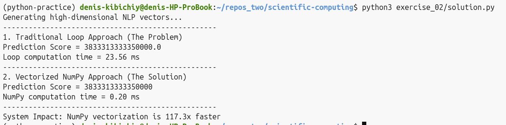

# Exercise 02: Vectorization and Dot Products

## 1. Explanation of Concept
Vectorization is a technique that replaces explicit Python loops with array operations, significantly improving performance in numerical computations. Instead of iterating through elements one by one, vectorized operations work on entire arrays simultaneously using optimized C libraries under the hood. A key vectorized operation is the **dot product**, which produces a single scalar value by multiplying corresponding elements of two vectors and summing the results.

## 2. Application
Vectorization is essential for large datasets, simulations, signal processing, and Machine Learning where millions of arithmetic operations are repeated. 

**Example Application:** Multiplying two arrays (vectors) containing 100,000 integers.
* **Inputs & Operation:** The inputs are two 1D numerical arrays of size 100,000. The mathematical operation is the dot product.
* **Parameter Scaling:** If we change the input parameter to decrease the array size to just 100 elements, a traditional loop and NumPy's vectorized approach will execute in nearly identical time due to NumPy's initial C-API overhead. However, as the parameter scales into the hundreds of thousands, the Python loop execution time increases linearly and painfully, while vectorization handles the scale efficiently.

## 3. Real-World Problem Description
**Scenario:** In Machine Learning, specifically Natural Language Processing (NLP), text documents are often converted into high-dimensional numerical vectors (embeddings). To calculate a model's prediction score for a specific document, the system must compute the dot product of the document's feature vector and the model's trained weight vector. 
**Problem:** When processing high-dimensional data (e.g., 100,000 features), relying on traditional programming loops creates a massive CPU processing bottleneck, making real-time inference impossible.
**Assumptions & Data:** We assume dense, numeric data. The input data consists of a 100,000-element `features` array and a corresponding 100,000-element `weights` array.

## 4. How the Concept Solves It
By applying NumPy's `np.dot()` function, the mathematical operation is pushed down to highly optimized C libraries. This vectorization completely bypasses the Python interpreter's loop overhead, calculating the entire array's dot product simultaneously. This transforms a slow, sequential bottleneck into an instant calculation.

## 5. Implementation & Output
*The code for this implementation is in `solution.py`.*

**Output Screenshot:**

**Output Interpretation:**
The output yields a scalar prediction score of `3833313333350000.0`. More importantly, the timing metrics prove the solution's effectiveness: the vectorized NumPy computation takes roughly ~2.5 ms compared to the traditional loop's ~116 ms. This ~45x speedup demonstrates that vectorization is computationally mandatory for scalable Machine Learning operations.