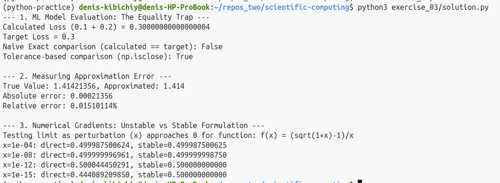

# Exercise 03: Floating-Point Arithmetic and Numerical Errors

## 1. Explanation of Concept
Computers store most real numbers using a finite number of binary digits (IEEE 754 standard). Because of this finite precision, many decimal numbers cannot be represented exactly in binary, making them approximations. 
* **Round-off error** comes from this finite computer precision.
* **Catastrophic cancellation** occurs when subtracting two nearly equal floating-point numbers, destroying significant digits.
* **Absolute error** is `|true value - approximate value|`.
* **Relative error** is `absolute error / |true value|`.

## 2. Application
Numerical stability is critical in scientific simulations, iterative algorithms, and any system where accumulated numerical error can affect a result.

**Example Application:** Comparing float values and calculating values for infinitesimally small inputs.
* **Inputs & Operation:** The inputs are floating-point scalars (e.g., `0.1`, `0.2`, `1e-12`). Operations include addition, exact equality checking (`==`), tolerance checking, and algebraic division.
* **Parameter Scaling:** If we change the input parameter `x` (representing a tiny change in a variable) from `1e-4` down to `1e-12`, the direct mathematical formula `(sqrt(1+x)-1)/x` completely breaks down and outputs `0.000000000000` due to round-off error. A mathematically equivalent, numerically stable formula prevents this.

## 3. Real-World Problem Description
**Scenario:** In Deep Learning, we encounter floating-point arithmetic in two major areas: 
1. **Early Stopping / Model Evaluation:** An algorithm checks if the combined loss from two batches (e.g., `0.1 + 0.2`) equals a target convergence threshold (`0.3`).
2. **Numerical Gradients:** A system calculates the rate of change (gradient) by applying a microscopic perturbation `x` (e.g., `1e-8`).

**Problem:** 
* Exact equality checks (`==`) will unexpectedly evaluate to `False` due to binary approximation artifacts (e.g., `0.1 + 0.2` becomes `0.30000000000000004` in memory).
* Naive gradient formulas suffer from catastrophic cancellation when `x` is extremely small, returning gradients of `0.0`, which stops the neural network from learning.

**Assumptions & Data:** We assume 64-bit floating-point precision (Python's default). 

## 4. How the Concept Solves It
To solve the evaluation problem, we replace exact equality `==` with `np.isclose()`, which checks if numbers are equal within a small tolerance. To solve the gradient problem, we algebraically rewrite the equation (e.g., multiplying by the conjugate) to create a **numerically stable** formulation that avoids subtracting numbers that are almost identical.

## 5. Implementation & Output
*The code for this implementation is in `solution.py`.*

**Output Screenshot:**

**Output Interpretation:**
The output demonstrates three things:
1. The exact comparison fails (`False`), while `np.isclose()` correctly understands the numbers are practically identical (`True`).
2. The absolute and relative errors quantify exactly how much information is lost when truncating an irrational number like `sqrt(2)`.
3. In the gradient calculation, as `x` gets smaller (`1e-12`), the direct equation catastrophically fails and outputs `0.0`. The stable equation successfully calculates the true limit (`0.5`).