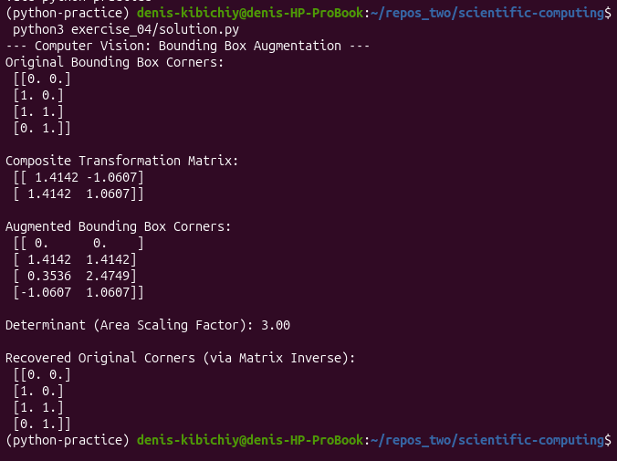
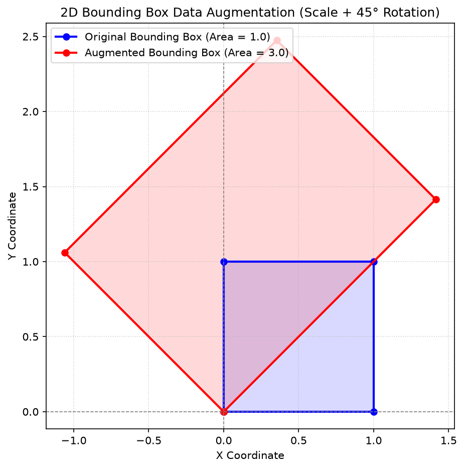

# Exercise 04: Matrix Algebra and Matrix Operations

## 1. Explanation of Concept
A matrix organizes numerical values into rows and columns. Rather than processing individual numbers, matrix algebra allows us to manipulate entire coordinate systems and datasets simultaneously:
* **Matrix Multiplication:** Combines rows of the first matrix with columns of the second ($c_{ij} = \sum a_{ik}b_{kj}$). In linear algebra, multiplying by a matrix applies a linear transformation (such as rotation, scaling, or shearing) to a vector space.

* **Determinant:** A scalar value computed from a square matrix that indicates how much the transformation scales area (in 2D) or volume (in 3D). If the determinant is `0`, the matrix is **singular** (non-invertible), meaning information is permanently collapsed.

* **Matrix Inverse ($A^{-1}$):** Reverses the transformation of matrix $A$, satisfying $A A^{-1} = I$ (where $I$ is the identity matrix).

## 2. Application
Matrix operations are the mathematical backbone of computer graphics, robotics, cryptography, and Machine Learning (neural network layers and feature transformations).

**Example Application:** Multiplying a $2 \times 2$ transformation matrix $A = \begin{bmatrix} 1 & 2 \\ 3 & 4 \end{bmatrix}$ by a coordinate vector $x = [5, 6]$ produces $Ax = [1(5)+2(6), 3(5)+4(6)] = [17, 39]$.
* **Inputs & Operations:** The inputs are a 2D coordinate matrix (rows of $[x, y]$ points) and $2 \times 2$ rotation/scaling matrices. Operations include matrix multiplication (`@`), transposition (`.T`), determinant (`np.linalg.det`), and matrix inversion (`np.linalg.inv`).
* **Parameter Scaling:** Changing the scaling matrix parameter on the x-axis from `2.0` to `0.0` causes the determinant to drop from `3.0` to `0.0`. Geometrically, this collapses the 2D bounding box into a 1D line. Mathematically, it makes the matrix singular, causing `np.linalg.inv()` to fail because the original 2D coordinates can no longer be recovered.

## 3. Real-World Problem Description
**Scenario:** In Computer Vision (specifically object detection models like YOLO), training datasets are often expanded using **Data Augmentation**, randomly rotating and scaling images so the model learns to recognize objects from any angle or size.

**Problem:** When an image is rotated and scaled, the ground-truth **bounding box** (defined by its 4 corner coordinates) must undergo the exact same transformation. Furthermore, during inference, if a model predicts a bounding box on a transformed image, we must be able to mathematically reverse the transformation to map the box back onto the original image.

**Assumptions & Data:** The object's bounding box is represented as a $4 \times 2$ NumPy array where each row is an $[x, y]$ corner coordinate. The augmentation applies a $45^\circ$ rotation and non-uniform scaling ($2.0\times$ width, $1.5\times$ height).

## 4. How the Concept Solves It
Instead of applying trigonometric formulas to each corner point one by one, we construct a $2 \times 2$ rotation matrix and a $2 \times 2$ scaling matrix, then combine them into a single composite transformation matrix (`transformation = rotation @ scale`). 
1. Multiplying the bounding box coordinates by `transformation.T` transforms all four corners in one vectorized step.
2. Computing `np.linalg.det(transformation)` gives the exact area scaling factor of the bounding box and confirms the transformation is reversible (`det != 0`).
3. Computing `np.linalg.inv(transformation)` allows us to reverse the augmentation and recover the exact original bounding box coordinates.

## 5. Implementation & Output
*The code for this implementation is in `solution.py`.*

**Output Screenshot:**

**Output Interpretation:**
The output displays the original $4 \times 2$ bounding box coordinates, the composite transformation matrix, and the newly augmented coordinates. The determinant is `3.0`, which confirms two things: the bounding box's area tripled ($2.0 \times 1.5 = 3.0$), and the matrix is invertible. Finally, applying the inverse matrix successfully recovers the original bounding box coordinates (with minor floating-point rounding near `0.0`).