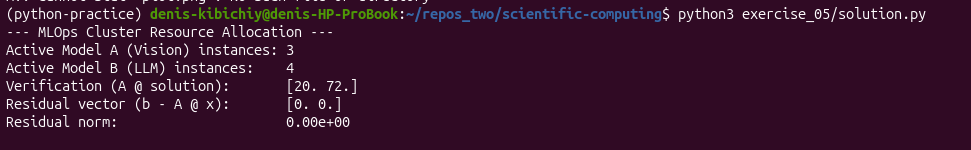
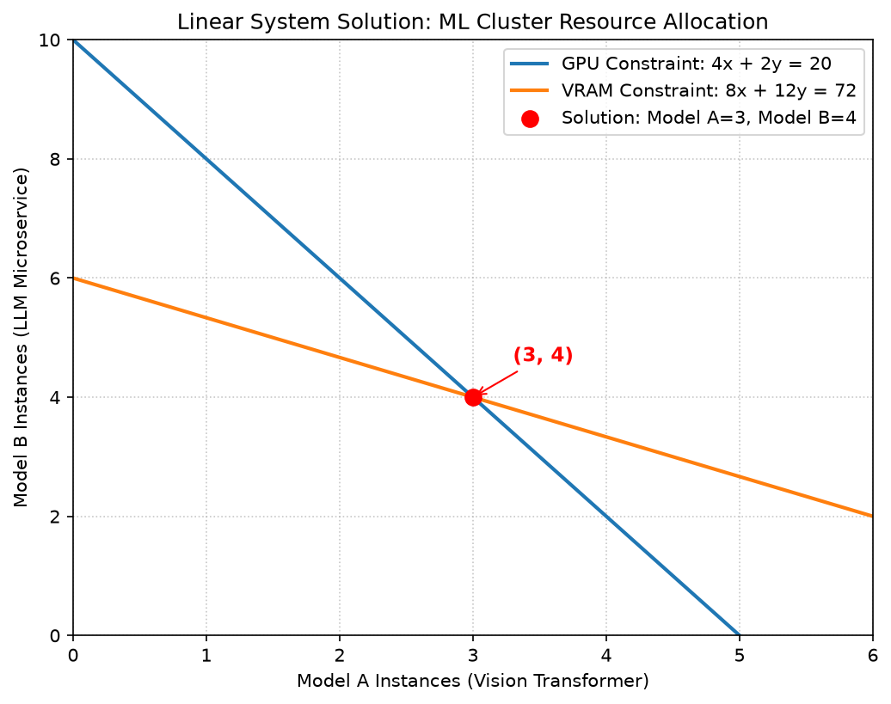

# Exercise 05: Solution of Systems of Linear Equations

## 1. Explanation of Concept
Many scientific and engineering problems can be modeled as a system of simultaneous linear equations written in matrix form as **$Ax = b$**:
* **$A$** is the coefficient matrix representing known rates or weights.
* **$x$** is the column vector of unknown variables we want to solve for.
* **$b$** is the column vector of known total outcomes or constraints.

Solving the system means finding the exact vector $x$ that satisfies all equations simultaneously. Geometrically, for a 2-variable system, each equation represents a straight line, and the solution $x$ is the exact point where the lines intersect. The **residual** ($r = b - Ax$) measures how close the computed solution is to the exact target; a residual norm near `0` confirms a valid solution.

## 2. Application
Linear systems are foundational to electrical circuit analysis, traffic-flow modeling, resource allocation, computer graphics, and estimating unknown parameters in Machine Learning models.

**Example Application:** Solving $2x + 3y = 8$ and $4x + y = 6$ translates to $A = \begin{bmatrix} 2 & 3 \\ 4 & 1 \end{bmatrix}$ and $b = [8, 6]$, yielding $x = 1, y = 2$.
* **Inputs & Operations:** The inputs are a $2 \times 2$ coefficient matrix $A$ and a $2$-element target vector $b$. Operations include solving the linear system (`np.linalg.solve`), matrix-vector multiplication (`A @ x`) for verification, and computing the Euclidean residual norm (`np.linalg.norm`).
* **Parameter Scaling:** Changing the target vector $b$ (e.g., increasing total GPU cores from `20` to `24`) shifts the corresponding constraint line, moving the intersection point to a new solution (`x = 4.5, y = 3.0`). However, if we modify matrix $A$ so that one row is an exact multiple of the other (linearly dependent), the lines become parallel and never intersect; `np.linalg.solve()` will raise a `LinAlgError` because the matrix is singular.

## 3. Real-World Problem Description
**Scenario:** An MLOps platform deploys two types of containerized Machine Learning models onto a shared GPU cluster:
* **Model A (Vision Transformer):** Consumes `4` GPU cores and `8 GB` of VRAM per instance.
* **Model B (LLM Microservice):** Consumes `2` GPU cores and `12 GB` of VRAM per instance.

**Problem:** The cluster monitoring dashboard reports a total active load of `20` GPU cores and `72 GB` of VRAM, but the container orchestrator's instance counter is offline. We need to determine the exact number of active Model A and Model B instances from the hardware telemetry alone.

**Assumptions & Data:** Each model instance consumes a fixed, deterministic amount of GPU cores and VRAM with zero idle overhead. The telemetry data is represented as matrix $A = \begin{bmatrix} 4 & 2 \\ 8 & 12 \end{bmatrix}$ and vector $b = [20, 72]$.

## 4. How the Concept Solves It
Rather than manually substituting equations or explicitly inverting $A$ (which is slower and less numerically stable), we use NumPy's `np.linalg.solve(A, b)`. Under the hood, this uses LU decomposition (via LAPACK) to find the exact intersection of the GPU and VRAM constraints in one step. We then verify the answer by computing `A @ x` and checking that the residual norm is `0.0`.

## 5. Implementation & Output
*The code for this implementation is in `solution.py`.*

**Terminal Output Screenshot:**

**Visual Solution Graph:**

**Output & Graph Interpretation:**
The solver outputs `3` active instances of Model A and `4` active instances of Model B. Verification via `A @ solution` reproduces `[20., 72.]` with a residual norm of `0.0`, confirming zero numerical error. In the graph, the blue line represents all combinations of models that use `20` GPU cores, and the orange line represents all combinations that use `72 GB` of VRAM. The red marker at `(3, 4)` visually confirms the unique intersection point where both hardware constraints are satisfied simultaneously.