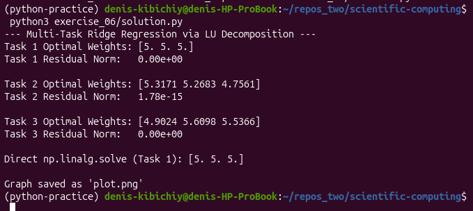
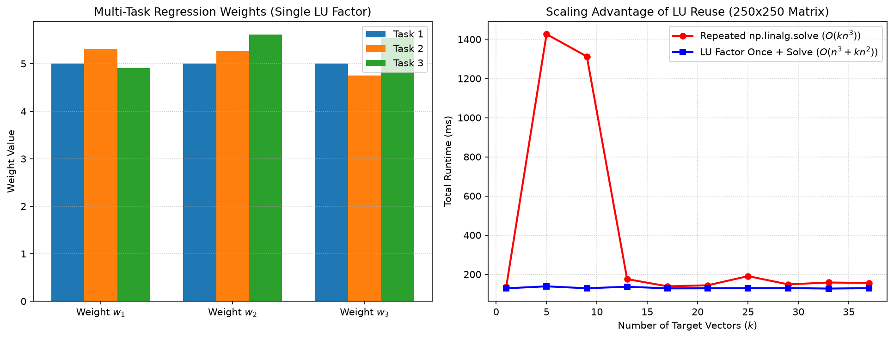

# Exercise 06: Gaussian Elimination and LU Decomposition

## 1. Explanation of Concept
**Gaussian elimination** solves a linear system $Ax = b$ by systematically eliminating variables row by row to transform $A$ into an upper-triangular matrix, then solving for $x$ via back-substitution.

**LU Decomposition** improves on this by factoring the coefficient matrix once into two triangular matrices:
$$PA = LU$$
* **$L$** is a lower-triangular matrix (storing the elimination multipliers).
* **$U$** is an upper-triangular matrix (the result of elimination).
* **$P$** is a permutation matrix (handling row swaps, or *pivoting*, for numerical stability).

Factoring $A$ costs $O(n^3)$ operations, while solving with the precomputed $L$ and $U$ factors via forward and back-substitution costs only $O(n^2)$. When $A$ stays fixed and only $b$ changes, LU decomposition avoids repeating the expensive $O(n^3)$ elimination.

## 2. Application
LU decomposition is widely used in finite-element simulations, real-time control systems, economic modeling, and Machine Learning pipelines where the same system matrix must be solved against many different target vectors.

**Example Application:** Solving a $3 \times 3$ system $Ax = b$ across three different measurement vectors using `scipy.linalg.lu_factor` and `scipy.linalg.lu_solve`.
* **Inputs & Operations:** A fixed $3 \times 3$ coefficient matrix $A$ and three $3$-element target vectors $b_1, b_2, b_3$. Operations include LU factorization (`lu_factor`), triangular solves (`lu_solve`), residual norm verification (`np.linalg.norm`), and a direct solver comparison (`np.linalg.solve`).
* **Parameter Scaling:** If we increase the number of target vectors $k$ (e.g., from `3` to `50` on a larger $250 \times 250$ feature matrix), calling `np.linalg.solve()` repeatedly scales poorly because it re-factors $A$ every single time. With LU decomposition, the upfront factorization cost is paid once, and each additional solve adds negligible time.

## 3. Real-World Problem Description
**Scenario:** In Machine Learning, **Multi-Task Ridge Regression** predicts multiple related target variables (e.g., forecasting 3 different energy metrics: peak load, average load, and grid loss) from the exact same set of input features. The closed-form solution for each target $i$ is given by the regularized normal equation:
$$(X^T X + \lambda I) w_i = X^T y_i$$

**Problem:** The regularized Gram matrix $A = X^T X + \lambda I$ is identical for every target task—only the right-hand side vector $b_i = X^T y_i$ changes. Running a full linear solver from scratch for every target wastes substantial compute time as the number of targets grows.

**Assumptions & Data:** The regularized Gram matrix $A$ is symmetric, diagonally dominant, and invertible. We solve for three separate target vectors `b_1`, `b_2`, and `b_3`, representing three distinct regression targets sharing the same feature space.

## 4. How the Concept Solves It
By calling `lu_factor(A)` **once**, we decompose the shared Gram matrix into its $L$ and $U$ factors. For each new regression target $b_i$, we pass the cached factors to `lu_solve((lu, piv), b_i)`. This produces the exact same optimal weight vector $w_i$ as `np.linalg.solve(A, b_i)` (with near-zero residuals) while eliminating redundant $O(n^3)$ matrix factorizations.

## 5. Implementation & Output
*The code for this implementation is in `solution.py`.*

**Terminal Output Screenshot:**

**Visual Analysis Graph:**

**Output & Graph Interpretation:**
For the first target task, `lu_solve` returns the exact weights `[5., 5., 5.]` with a residual norm of `0.0`, matching the direct `np.linalg.solve` output. In the generated figure:
* **Left Panel:** Displays the learned regression weights ($w_1, w_2, w_3$) across all three target tasks derived from the single LU factorization.
* **Right Panel:** Benchmarks a $250 \times 250$ matrix solved across $1$ to $40$ target vectors. The direct solver's cumulative runtime grows steeply (linearly with a high slope), whereas LU reuse stays nearly flat after the initial factorization, demonstrating its scalability for multi-task ML workloads.