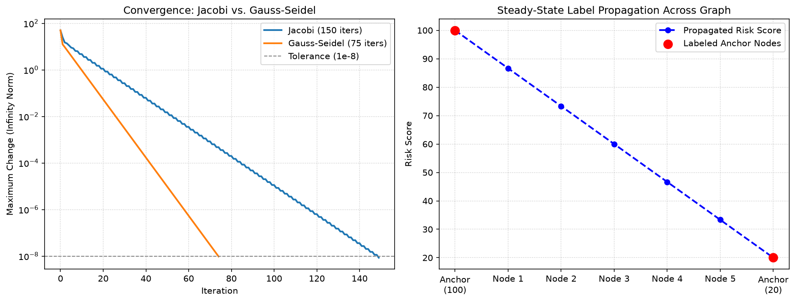

# Exercise 07: Iterative Methods for Linear Systems

## 1. Explanation of Concept
Direct solvers like Gaussian elimination or LU decomposition require $O(n^3)$ operations and dense memory storage, making them impractical for massive sparse matrices. **Iterative methods** start with an initial guess $x^{(0)}$ and repeatedly refine it until the maximum change between successive iterations falls below a chosen tolerance (`tol`):
* **Jacobi Method:** Updates every element $x_i$ using *only* values from the previous iteration. It is easy to parallelize, but converges more slowly.
* **Gauss-Seidel Method:** Updates each element $x_i$ in-place and immediately uses the newly computed values for subsequent elements in the same iteration. For diagonally dominant matrices, this typically converges in roughly **half the iterations** of Jacobi.

## 2. Application
Iterative solvers are essential for large sparse linear systems in heat transfer, structural engineering, electrical networks, image reconstruction, and graph-based Machine Learning algorithms.

**Example Application:** Solving a $5 \times 5$ sparse tridiagonal system $Ax = b$ using both Jacobi and Gauss-Seidel until the infinity-norm error ($\|x^{(k+1)} - x^{(k)}\|_\infty$) drops below `1e-8`.
* **Inputs & Operations:** A sparse, diagonally dominant $5 \times 5$ matrix $A$, a boundary vector $b$, a convergence tolerance (`tol = 1e-8`), and `max_iter = 500`. Operations include matrix-vector products, in-place element updates, and infinity-norm error tracking.
* **Parameter Scaling:** Tightening the tolerance parameter from `1e-8` to `1e-12` forces both algorithms to run additional iterations to achieve higher precision, extending the straight decay lines on the semi-log plot. Conversely, if the diagonal entries of $A$ are reduced so the matrix loses diagonal dominance (e.g., changing `2.0` to `1.0`), both iterative methods will diverge to infinity instead of converging.

## 3. Real-World Problem Description
**Scenario:** In Fraud Detection and **Graph-Based Semi-Supervised Learning**, only a tiny fraction of accounts have confirmed labels, while millions of unlabeled accounts are connected via transaction or similarity graphs. Label propagation estimates the unknown risk score of each unlabeled node by setting it equal to the average of its immediate neighbors—producing a large sparse linear system (a graph Laplacian).

**Problem:** Consider a chain of 5 unlabeled accounts sitting between two verified anchor accounts: a confirmed high-risk account (score = `100`) on the left and a verified low-risk account (score = `20`) on the right. In production, this graph scales to millions of nodes, making direct $O(n^3)$ matrix factorization impossible.

**Assumptions & Data:** Each unlabeled node's steady-state risk score is the arithmetic mean of its two neighbors ($2x_i - x_{i-1} - x_{i+1} = 0$). The system is represented by the $5 \times 5$ tridiagonal matrix $A$ and boundary vector $b = [100, 0, 0, 0, 20]$.

## 4. How the Concept Solves It
Because each node only depends on its immediate neighbors, $A$ is sparse and diagonally dominant. Both Jacobi and Gauss-Seidel iteratively diffuse the known boundary risk scores across the unlabeled nodes without ever factoring or inverting $A$. Tracking the maximum score change per iteration guarantees we stop as soon as the risk scores stabilize within `1e-8`.

## 5. Implementation & Output
*The code for this implementation is in `solution.py`.*

**Terminal Output Screenshot:**

**Visual Convergence & Propagation Graph:**

**Output & Graph Interpretation:**
Both iterative methods converge to the exact direct solution `[86.67, 73.33, 60.00, 46.67, 33.33]`, representing a smooth risk gradient between the `100` and `20` anchor nodes.
* **Left Panel (Semi-Log Convergence):** Both error curves drop linearly on the logarithmic y-axis, confirming linear convergence. Gauss-Seidel reaches the `1e-8` threshold in roughly half as many iterations as Jacobi because it immediately propagates updated neighbor scores within each sweep.
* **Right Panel (Propagated Risk Scores):** Visualizes the final harmonic risk scores across the 5 unlabeled nodes anchored between the two labeled endpoints.