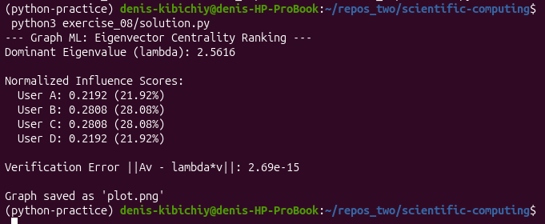
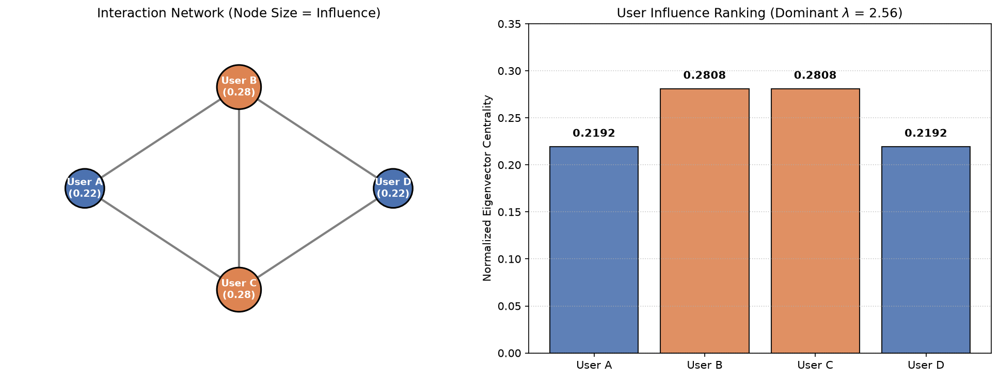

# Exercise 08: Eigenvalues and Eigenvectors

## 1. Explanation of Concept
For a square matrix $A$, an **eigenvector** $v$ is a non-zero vector whose direction remains unchanged when transformed by $A$. It satisfies the fundamental equation:
$$Av = \lambda v$$
* **$\lambda$ (Eigenvalue):** A scalar indicating how much the eigenvector is stretched, compressed, or reversed by the transformation.
* **Dominant Eigenpair:** The eigenvalue with the largest magnitude ($\lambda_{\max}$) and its corresponding eigenvector. In non-negative network matrices (by the Perron–Frobenius theorem), this dominant eigenvector has all positive entries and captures the steady-state structural importance of every node.

## 2. Application
Eigenvalues and eigenvectors power Google PageRank, Principal Component Analysis (PCA) for dimensionality reduction, image compression, vibration analysis, and network centrality in Graph ML.

**Example Application:** Computing the dominant eigenvalue and normalized eigenvector of a $4 \times 4$ undirected adjacency matrix to rank node influence.
* **Inputs & Operations:** A symmetric $4 \times 4$ binary adjacency matrix $A$. Operations include eigendecomposition (`np.linalg.eig`), selecting the dominant eigenpair (`np.argmax`), $L_1$ normalization (`v / v.sum()`), and residual verification (`np.linalg.norm(A @ v - lambda * v)`).
* **Parameter Scaling:** If we modify the adjacency matrix to add a direct connection between Node A and Node D (`A[0, 3] = 1.0` and `A[3, 0] = 1.0`), the network becomes a fully connected graph ($K_4$). The dominant eigenvalue increases from `2.5616` to `3.0000`, and the centrality scores equalize to `0.2500` across all four nodes because every node now has identical structural influence.

## 3. Real-World Problem Description
**Scenario:** In Social Network Analysis and **Graph-Based Recommendation Systems**, platforms need to identify the most influential users (or "seed nodes") to maximize content reach or detect key hubs in a community. Simply counting a user's direct followers (degree centrality) is often misleading—being connected to a few highly influential hubs is more valuable than being connected to many isolated accounts.

**Problem:** Given an undirected interaction graph of 4 users (`User A`, `User B`, `User C`, `User D`), we need to compute a mathematically grounded influence score for each user where a node's importance is proportional to the sum of the importance of its neighbors.

**Assumptions & Data:** Interactions are symmetric and unweighted (represented by `1.0` for an active connection and `0.0` for no connection). The network is connected, ensuring a unique, strictly positive dominant eigenvector.

## 4. How the Concept Solves It
By representing the interaction network as an adjacency matrix $A$, the recursive definition of influence ("important nodes connect to important nodes") translates directly into the eigenvalue equation $Av = \lambda v$. Using `np.linalg.eig(A)`, we extract the dominant eigenvector and normalize it so the scores sum to `1.0` (100% of total network influence). Verifying $\|Av - \lambda v\|_2 \approx 0$ confirms the numerical accuracy of the eigenpair.

## 5. Implementation & Output
*The code for this implementation is in `solution.py`.*

**Terminal Output Screenshot:**

**Visual Network & Centrality Graph:**

**Output & Graph Interpretation:**
The dominant eigenvalue is `2.5616`, and the verification error $\|Av - \lambda v\|_2$ is near machine epsilon (`~1e-16`), confirming an exact eigenpair.
* **Left Panel (Interaction Network):** Displays the graph topology with node sizes scaled by their eigenvector centrality. `User B` and `User C` sit at the structural core (connected to 3 peers each, including each other), while `User A` and `User D` sit on the periphery.
* **Right Panel (Centrality Ranking):** Shows the normalized influence distribution. `User B` and `User C` each hold `28.08%` of the network's influence, while `User A` and `User D` each hold `21.92%`.