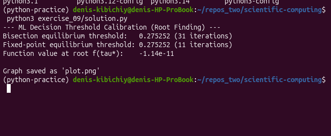
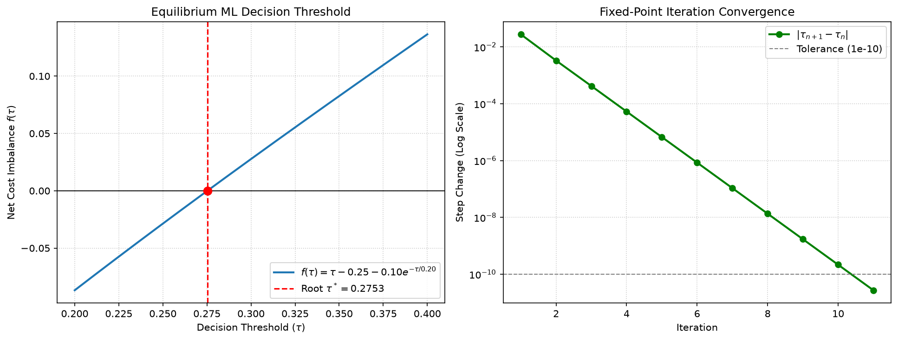

# Exercise 09: Root Finding — Bisection and Fixed-Point Methods

## 1. Explanation of Concept
A **root** of a function $f(x)$ is a value $r$ such that $f(r) = 0$. Many nonlinear equations cannot be solved algebraically in closed form, requiring numerical root-finding methods:
* **Bisection Method:** Starts with a bracket $[a, b]$ where $f(a)$ and $f(b)$ have opposite signs ($f(a) \cdot f(b) < 0$). By the Intermediate Value Theorem, a root must lie inside. The algorithm repeatedly halves the interval and keeps the sub-interval containing the sign change until the interval width falls below a tolerance (`xtol`). It is guaranteed to converge, though relatively slowly.
* **Fixed-Point Iteration:** Rewrites $f(x) = 0$ into the form $x = g(x)$ and iteratively computes $x_{n+1} = g(x_n)$ starting from an initial guess $x_0$. It converges whenever $|g'(x)| < 1$ near the root.

## 2. Application
Root-finding algorithms are used to locate break-even points, compute internal rates of return, calibrate physical and statistical models, and find optimal operating thresholds in engineering and Machine Learning.

**Example Application:** Finding the root of a nonlinear exponential balance equation $f(\tau) = \tau - 0.25 - 0.10 e^{-\tau/0.20} = 0$ on the interval $[0.20, 0.40]$.
* **Inputs & Operations:** A continuous nonlinear function $f(\tau)$, an initial bracket `[0.20, 0.40]`, an initial fixed-point guess $\tau_0 = 0.30$, and a stopping tolerance `xtol = 1e-10`. Operations include `scipy.optimize.root_scalar(..., method="bisect")` and iterative evaluation of $g(\tau) = 0.25 + 0.10 e^{-\tau/0.20}$.
* **Parameter Scaling:** Tightening the tolerance from `1e-10` to `1e-14` forces both methods to execute additional iterations to narrow the error further. Conversely, if we change the bisection bracket to `[0.30, 0.40]` where $f(0.30) > 0$ and $f(0.40) > 0$ (no sign change), `root_scalar` will raise a `ValueError` because the bracket no longer guarantees a root.

## 3. Real-World Problem Description
**Scenario:** In a **Fraud Detection Machine Learning** pipeline, a binary classifier outputs a fraud probability $p \in [0, 1]$ for each transaction. Operations must choose a decision threshold $\tau$ above which transactions are flagged.
* Setting $\tau$ too low causes excessive false positives (blocking legitimate customers).
* Setting $\tau$ too high causes missed fraud (exponentially increasing financial loss).

**Problem:** The net cost-imbalance between false-positive friction and missed-fraud risk is modeled by the nonlinear equation:
$$f(\tau) = \tau - 0.25 - 0.10 e^{-\tau / 0.20}$$
We need to find the exact equilibrium threshold $\tau^*$ where $f(\tau^*) = 0$ so that both risk components are balanced.

**Assumptions & Data:** The cost-imbalance function is continuous and strictly increasing on $\tau \in [0.20, 0.40]$, ensuring a unique root. Both methods target a precision of `1e-10`.

## 4. How the Concept Solves It
1. **Bisection (`scipy.optimize.root_scalar`):** Evaluates $f(0.20) < 0$ and $f(0.40) > 0$, then halves the search space until the equilibrium threshold $\tau^*$ is pinned down within `1e-10`.
2. **Fixed-Point Iteration:** Rearranges $f(\tau) = 0$ into $\tau = 0.25 + 0.10 e^{-\tau/0.20}$. Because $|g'(\tau)| = 0.5 e^{-\tau/0.20} < 1$ across the interval, iterating $\tau_{n+1} = g(\tau_n)$ is mathematically guaranteed to contract directly onto the exact same root.

## 5. Implementation & Output
*The code for this implementation is in `solution.py`.*

**Terminal Output Screenshot:**

**Visual Root & Convergence Graph:**

**Output & Graph Interpretation:**
Both methods agree to 6+ decimal places, finding the optimal equilibrium decision threshold at $\tau^* \approx 0.275361$ (`27.54%` fraud probability), with $f(\tau^*) \approx 0$.
* **Left Panel (Cost-Balance Curve):** Plots $f(\tau)$ over $[0.20, 0.40]$. The red dashed line marks the exact zero-crossing where false-positive friction and missed-fraud risk reach equilibrium.
* **Right Panel (Fixed-Point Convergence):** Shows the absolute step change $|\tau_{n+1} - \tau_n|$ dropping linearly on a logarithmic scale, reaching the `1e-10` stopping criterion in just 11 iterations.