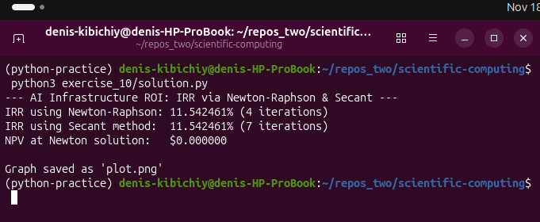
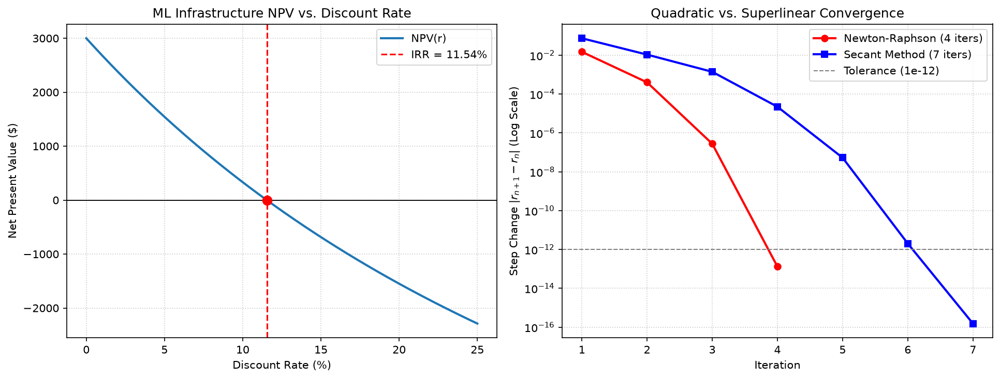

# Exercise 10: Root Finding — Newton-Raphson and Secant Methods

## 1. Explanation of Concept
Open root-finding methods use local slope information to jump rapidly toward a root $f(r) = 0$, converging much faster than bracketing methods like Bisection when given a reasonable starting guess:
* **Newton-Raphson Method:** Uses the exact first derivative $f'(x_n)$ to project a tangent line to the x-axis:
  $$x_{n+1} = x_n - \frac{f(x_n)}{f'(x_n)}$$
  Near a simple root, it achieves **quadratic convergence** (roughly doubling the number of accurate decimal digits each iteration).
* **Secant Method:** Approximates the derivative using the finite-difference slope between the two most recent points $x_n$ and $x_{n-1}$:
  $$x_{n+1} = x_n - f(x_n) \frac{x_n - x_{n-1}}{f(x_n) - f(x_{n-1})}$$
  It avoids needing an analytical derivative while still achieving **superlinear convergence** ($\approx 1.618$).

## 2. Application
Newton-Raphson and Secant methods are widely used in optimization subproblems (e.g., Newton's method in logistic regression), circuit simulation, model calibration, and financial rate-of-return calculations.

**Example Application:** Computing the Internal Rate of Return (IRR)—the discount rate $r$ where Net Present Value $\text{NPV}(r) = 0$—for a multi-year cash flow series.
* **Inputs & Operations:** A cash-flow vector `[-10000, 3000, 3500, 4000, 2500]`, initial guesses (`x0 = 0.10` for Newton; `x0 = 0.05, x1 = 0.20` for Secant), and tolerance `xtol = 1e-12`. Operations include `scipy.optimize.root_scalar` with `method="newton"` (using analytical derivative `d_npv`) and `method="secant"` (derivative-free).
* **Parameter Scaling:** Changing the initial investment parameter from `-10000` to `-11000` shifts the entire NPV curve downward, lowering the break-even IRR. Conversely, choosing a poor initial guess far from the root (such as `x0 = -0.95`, near the pole at $r = -1$) can cause the tangent line to overshoot and diverge, highlighting why open methods trade guaranteed convergence for speed.

## 3. Real-World Problem Description
**Scenario:** A Data Science team proposes an upfront `$10,000` investment to deploy an on-premise GPU inference server and automated ML pipeline. The system is projected to generate annual operational cost savings of `$3,000`, `$3,500`, `$4,000`, and `$2,500` over the next four years.

**Problem:** Leadership needs the exact **Internal Rate of Return (IRR)**—the discount rate $r$ at which the project's Net Present Value equals zero:
$$\text{NPV}(r) = \sum_{t=0}^{4} \frac{CF_t}{(1 + r)^t} = 0$$
Because this is a degree-4 rational equation, it cannot be solved cleanly by hand and requires a fast numerical root finder.

**Assumptions & Data:** Cash flows occur at fixed annual intervals (`t = 0, 1, 2, 3, 4`) with a single sign change (initial outflow followed by inflows), guaranteeing a unique positive IRR. Both solvers target a precision of `1e-12`.

## 4. How the Concept Solves It
1. **Newton-Raphson:** Because $\text{NPV}(r)$ is smooth and easily differentiable, we supply its exact analytical derivative $\text{NPV}'(r) = \sum_{t=1}^{4} \frac{-t \cdot CF_t}{(1 + r)^{t+1}}$ to `root_scalar(..., method="newton")`, snapping onto the exact IRR in just a handful of iterations.
2. **Secant Method:** When an analytical derivative is unavailable or expensive to compute (common in black-box financial or ML simulations), `root_scalar(..., method="secant")` estimates the slope from two initial guesses (`5%` and `20%`) and reaches the exact same root with only a couple of extra iterations.

## 5. Implementation & Output
*The code for this implementation is in `solution.py`.*

**Terminal Output Screenshot:**

**Visual NPV Curve & Convergence Graph:**

**Output & Graph Interpretation:**
Both Newton-Raphson and the Secant method converge to the exact same IRR of approximately `11.54%`, with $\text{NPV}(r^*) = 0.000000$.
* **Left Panel (NPV vs. Discount Rate):** Plots $\text{NPV}(r)$ from `0%` to `25%`. The curve crosses zero at `11.54%`—any corporate hurdle rate below this threshold means the ML infrastructure investment is profitable ($\text{NPV} > 0$).
* **Right Panel (Convergence Rate Comparison):** Shows the absolute error dropping on a logarithmic scale. Notice how both curves bend sharply downward (quadratic and superlinear convergence), reaching `1e-12` precision in far fewer iterations than linear methods like Bisection or Fixed-Point.