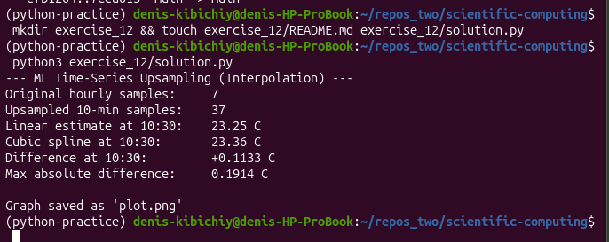
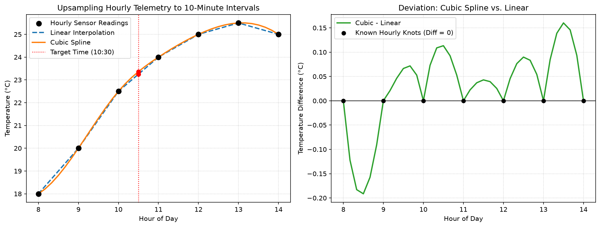

# Exercise 12: Interpolation (Linear and Cubic Splines)

## 1. Explanation of Concept
**Interpolation** estimates unknown values that lie *between* discrete, known data points $(x_i, y_i)$. Unlike regression (which fits a trend line that may not touch every point), an interpolating function passes **exactly** through every known data point:
* **Linear Interpolation:** Connects each pair of adjacent points with a straight line segment. It is fast and never overshoots, but produces sharp corners (discontinuous first derivatives) at the known data points.
* **Cubic Spline Interpolation:** Fits a separate third-degree (cubic) polynomial between each pair of adjacent points while enforcing continuous first and second derivatives at the junctions ("knots"). This produces a smooth, natural curve without the wild oscillations common to high-degree global polynomials (Runge's phenomenon).

## 2. Application
Interpolation is essential for missing-value imputation, sensor calibration, resampling time-series signals, animation keyframes, and aligning multi-rate datasets in Data Science.

**Example Application:** Upsampling 7 hourly temperature readings (`08:00` to `14:00`) into 10-minute intervals (`1/6` hour) using `scipy.interpolate.interp1d` and `CubicSpline`.
* **Inputs & Operations:** Two 1D NumPy arrays (`hours` and `temperature`), a dense query grid (`ten_minute_times`), and a specific target timestamp (`10.5` for `10:30`). Operations include piecewise linear interpolation (`interp1d(..., kind="linear")`), cubic spline construction (`CubicSpline`), and evaluating both interpolants across the upsampled grid.
* **Parameter Scaling:** Changing the resampling frequency parameter from 10-minute intervals (`1/6` hour) to 1-minute intervals (`1/60` hour) increases the output resolution by $10\times$ without needing to refit the spline. However, if we query a timestamp *outside* the `[8, 14]` range (extrapolation), `interp1d` will raise a `ValueError` by default, and `CubicSpline` can diverge rapidly because splines are only reliable within the observed bounds.

## 3. Real-World Problem Description
**Scenario:** In a **Smart-Grid Energy Forecasting** ML pipeline, a machine learning model predicts electricity demand every **10 minutes** using both smart-meter power readings (logged every 10 minutes) and ambient temperature features. However, the external weather API only logs ambient temperature **once per hour**.

**Problem:** To train the ML model without dropping 83% of the smart-meter records, we must upsample the hourly temperature telemetry to 10-minute intervals so both time series align on the exact same timestamps.

**Assumptions & Data:** Ambient temperature changes continuously and smoothly over time rather than jumping instantaneously. The input dataset consists of 7 hourly readings from `08:00` to `14:00`: `[18.0, 20.0, 22.5, 24.0, 25.0, 25.5, 25.0]` °C.

## 4. How the Concept Solves It
1. **Linear Interpolation (`interp1d`):** Provides a simple baseline by drawing straight lines between consecutive hourly measurements.
2. **Cubic Spline (`CubicSpline`):** Models the smooth physical curvature of daytime warming and afternoon leveling, producing more realistic 10-minute feature values (and smooth rate-of-change derivatives) for the downstream ML model.

## 5. Implementation & Output
*The code for this implementation is in `solution.py`.*

**Terminal Output Screenshot:**

**Visual Interpolation & Difference Graph:**

**Output & Graph Interpretation:**
At `10:30` (`t = 10.5`), linear interpolation estimates `23.25 °C` (the exact midpoint between `22.5` and `24.0`), while the cubic spline estimates `23.34 °C`, capturing the upward curvature of the morning warming trend.
* **Left Panel (Upsampled Curves):** Both curves pass exactly through every hourly sensor point (black dots), but the cubic spline (orange) smoothly rounds the transitions—especially around the `13:00` peak—whereas linear interpolation (blue) creates sharp, artificial kinks.
* **Right Panel (Method Difference):** Plots `Cubic - Linear` across the day. The difference is `0.0` at every integer hour (exact agreement at known points) and peaks between hours where curvature is strongest, illustrating where spline interpolation adds value to ML time-series features.