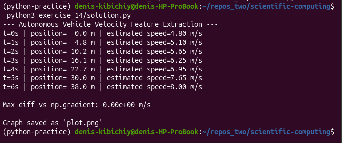
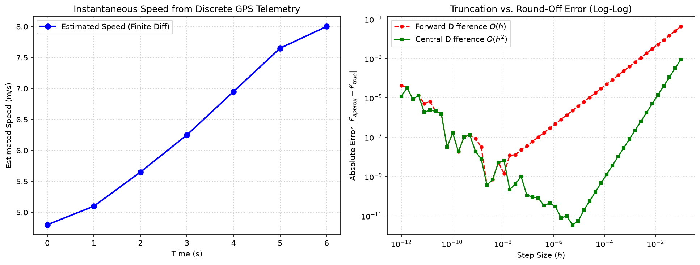

# Exercise 14: Numerical Differentiation

## 1. Explanation of Concept
A **derivative** $f'(x)$ measures the instantaneous rate of change of a quantity. When an analytical formula is unavailable—such as with discrete sensor telemetry or black-box loss functions—we approximate the derivative using **finite differences** over a small step size $h$:
* **Forward Difference:** $f'(x) \approx \frac{f(x + h) - f(x)}{h}$ — First-order accurate ($O(h)$), used at the left boundary of a dataset.
* **Backward Difference:** $f'(x) \approx \frac{f(x) - f(x - h)}{h}$ — First-order accurate ($O(h)$), used at the right boundary.
* **Central Difference:** $f'(x) \approx \frac{f(x + h) - f(x - h)}{2h}$ — Second-order accurate ($O(h^2)$), used for interior points because the first-order truncation errors cancel out symmetrically.

## 2. Application
Numerical differentiation is used to compute velocity and acceleration from position sensors, verify backpropagation gradients in Deep Learning (*gradient checking*), and perform sensitivity analysis on complex models.

**Example Application:** Estimating instantaneous velocity from 7 discrete 1-second GPS position readings using forward, central, and backward finite differences, and benchmarking step-size error on a smooth test function.
* **Inputs & Operations:** Two 1D NumPy arrays (`time` and `position`) and a logarithmic grid of step sizes $h \in [10^{-12}, 10^{-1}]$. Operations include finite-difference boundary/interior stencils, verification against `np.gradient()`, and absolute error evaluation.
* **Parameter Scaling:** Reducing the step size $h$ decreases **truncation error** ($O(h)$ for forward, $O(h^2)$ for central), making the derivative more accurate—up to a point. Once $h$ drops below $\approx 10^{-6}$ (central) or $\approx 10^{-8}$ (forward), subtracting nearly identical floating-point numbers triggers **round-off error** (catastrophic cancellation), causing the total error to climb back up in a characteristic V-shaped curve.

## 3. Real-World Problem Description
**Scenario:** An **Autonomous Driving Perception & Trajectory ML Model** predicts a vehicle's future path using kinematic features: position, instantaneous speed, and acceleration. However, the onboard GPS receiver only logs raw 1D displacement (in meters) once per second—it does not directly output instantaneous velocity.

**Problem:** We need to engineer an accurate instantaneous speed feature vector from the discrete GPS position log without introducing artificial lag, while understanding how sampling step size $h$ affects numerical derivative accuracy.

**Assumptions & Data:** The vehicle moves smoothly along a 1D path with negligible GPS measurement noise. Telemetry is sampled uniformly at $\Delta t = 1\text{ s}$:
* **Time (s):** `[0, 1, 2, 3, 4, 5, 6]`
* **Position (m):** `[0.0, 4.8, 10.2, 16.1, 22.7, 30.0, 38.0]`

## 4. How the Concept Solves It
We apply a **central difference** stencil to all interior timestamps (`t = 1` through `5`), which averages the forward and backward slopes to achieve $O(h^2)$ accuracy without phase lag. At the endpoints (`t = 0` and `t = 6`), where two-sided neighbors do not exist, we fall back to forward and backward differences respectively. We also verify our manual implementation against NumPy's built-in `np.gradient()`.

## 5. Implementation & Output
*The code for this implementation is in `solution.py`.*

**Terminal Output Screenshot:**

**Visual Velocity Profile & Step-Size Error Graph:**

**Output & Graph Interpretation:**
The estimated speed rises steadily from `4.80 m/s` at `t = 0 s` to `8.00 m/s` at `t = 6 s`, matching `np.gradient(position, time)` to machine precision (`0.00e+00` difference) and revealing consistent vehicle acceleration (~`0.53 m/s²`).
* **Left Panel (Velocity Feature Extraction):** Shows the smoothly increasing speed profile extracted from the discrete GPS position samples.
* **Right Panel (Step-Size Error Analysis):** A log-log plot comparing forward vs. central difference error on $f(x) = \sin(x)$ at $x = 1.0$. Central difference drops twice as fast ($O(h^2)$ slope vs. $O(h)$) and reaches a much lower error floor ($\sim 10^{-11}$) before floating-point round-off error takes over for ultra-small $h$.