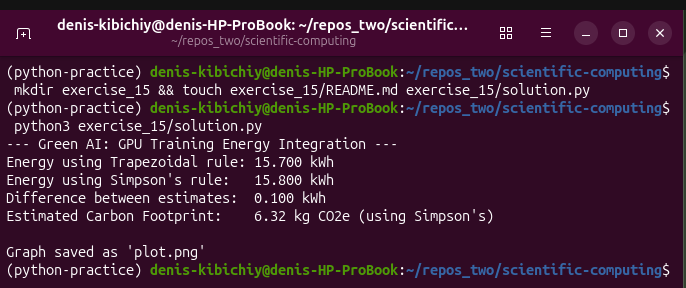
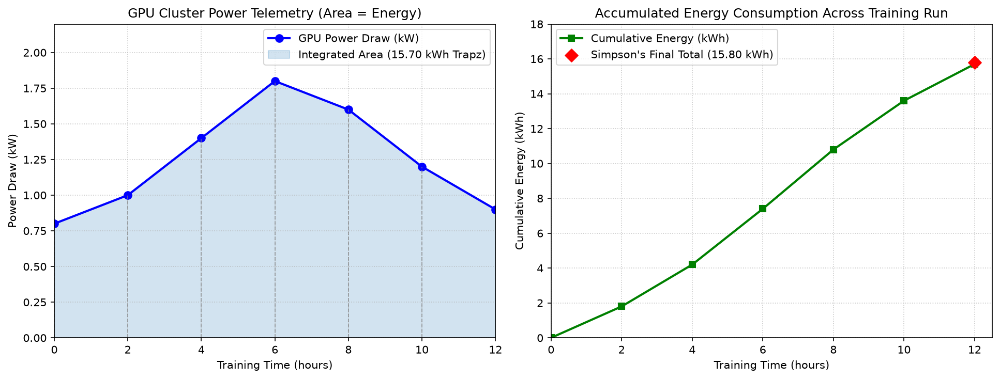

# Exercise 15: Numerical Integration

## 1. Explanation of Concept
A definite **integral** $\int_a^b f(t)\,dt$ represents the accumulated quantity or total area under a curve over an interval $[a, b]$. When a function is only known at discrete sample points (such as hardware telemetry), we approximate the integral numerically:
* **Trapezoidal Rule:** Connects adjacent data points with straight lines and sums the areas of the resulting trapezoids. It is second-order accurate ($O(h^2)$) and works on any spacing.
* **Simpson's Rule:** Fits parabolic (quadratic) segments across pairs of intervals to capture curvature. For smooth functions with an even number of intervals, it achieves fourth-order accuracy ($O(h^4)$), making it noticeably more accurate than the trapezoidal rule for the same step size.

## 2. Application
Numerical integration is used to compute total energy consumption from power telemetry, distance traveled from velocity logs, probability masses (AUC-ROC in Machine Learning), and signal energy.

**Example Application:** Integrating 7 discrete power readings sampled every 2 hours (`0` to `12` hours) using `np.trapezoid()` and `scipy.integrate.simpson()`.
* **Inputs & Operations:** Two 1D NumPy arrays (`time_hours` and `power_kw`). Operations include trapezoidal integration (`np.trapezoid`), Simpson's rule (`simpson`), cumulative integration (`cumulative_trapezoid`), and comparing the absolute discrepancy between the two methods.
* **Parameter Scaling:** If we increase the sampling frequency (reducing the interval parameter $\Delta t$ from `2 hours` down to `10 minutes`), both the trapezoidal and Simpson estimates converge toward the exact continuous integral, and the `0.100 kWh` difference between them shrinks rapidly. Conversely, sampling too coarsely (e.g., every `6 hours`) misses the mid-run power peak at `t = 6 h`, causing severe underestimation.

## 3. Real-World Problem Description
**Scenario:** In **Green AI and MLOps**, engineering teams track the electrical energy consumption (kWh) and carbon footprint of training deep learning models on multi-GPU clusters. A cluster power monitor logs total GPU rack power draw (in kW) every 2 hours across a 12-hour training run as batch processing, checkpointing, and validation phases cause power draw to rise and fall.

**Problem:** Instantaneous power readings (kW) alone do not tell us the total electricity billed or the carbon emissions generated. We need to integrate the discrete power-versus-time telemetry to compute total energy consumed (kWh) and estimate the training run's $\text{CO}_2$ footprint.

**Assumptions & Data:** Power draw varies smoothly between 2-hour telemetry snapshots. Grid carbon intensity is assumed to be `0.40 kg CO2e/kWh`.
* **Time (hours):** `[0, 2, 4, 6, 8, 10, 12]`
* **GPU Cluster Power (kW):** `[0.8, 1.0, 1.4, 1.8, 1.6, 1.2, 0.9]`

## 4. How the Concept Solves It
Because energy is the time-integral of power ($E = \int_{0}^{12} P(t)\,dt$), we apply both `np.trapezoid()` and `scipy.integrate.simpson()` directly to the telemetry arrays. Comparing both methods quantifies discretization uncertainty, while `cumulative_trapezoid()` lets us track how energy accumulates hour by hour throughout the training job.

## 5. Implementation & Output
*The code for this implementation is in `solution.py`.*

**Terminal Output Screenshot:**

**Visual Power Integration & Cumulative Energy Graph:**

**Output & Graph Interpretation:**
The trapezoidal rule estimates **`15.700 kWh`**, while Simpson's rule estimates **`15.800 kWh`** (a difference of `0.100 kWh`, corresponding to `~6.32 kg CO2e` at `0.40 kg/kWh`). Simpson's rule is slightly higher because its parabolic segments capture the upward concavity around the `1.8 kW` peak at hour 6, whereas straight trapezoids slightly clip the top of the curve.
* **Left Panel (Area Under Power Curve):** Visualizes the GPU power draw over the 12-hour run, with the shaded trapezoidal segments illustrating the exact area being summed.
* **Right Panel (Cumulative Energy):** Shows total energy accumulating monotonically from `0 kWh` to `15.70 kWh`, with the steepest slope occurring between hours 4 and 8 during peak GPU utilization.