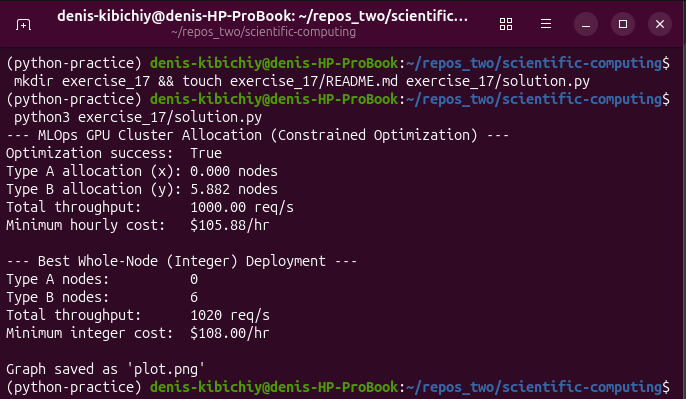
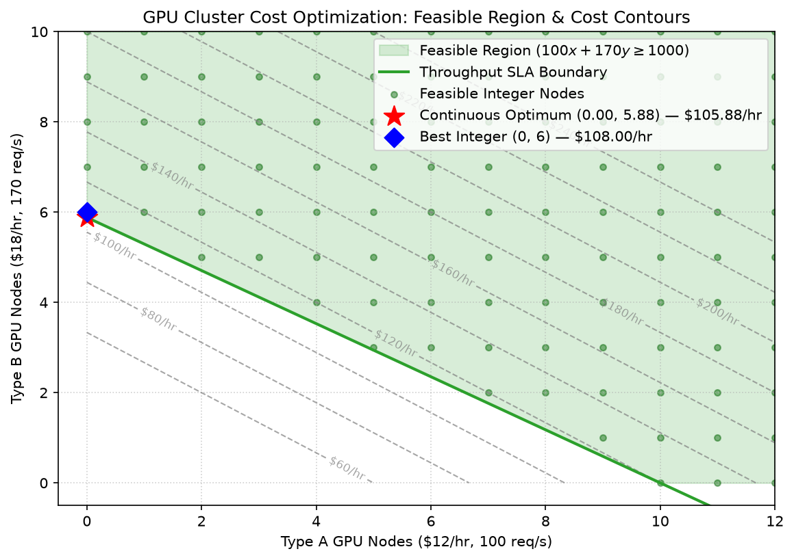

# Exercise 17: Numerical Optimization

## 1. Explanation of Concept
**Numerical optimization** finds the input vector $x^*$ that minimizes (or maximizes) an **objective function** $f(x)$ subject to a set of rules called **constraints**:
$$\min_{x} f(x) \quad \text{subject to} \quad g(x) \ge 0, \quad x \ge 0$$
* **Objective Function:** The scalar metric to minimize (e.g., operating cost, loss, latency) or maximize (e.g., throughput, profit).
* **Constraints & Bounds:** Real-world limits that define the **feasible region**—the set of all valid solutions. Any solution outside this region is invalid even if it has a lower cost.
* **Continuous vs. Integer Solutions:** Solvers like **SLSQP** (Sequential Least Squares Programming) treat variables as continuous real numbers. When hardware or resources must be provisioned in whole units, we evaluate nearby integer combinations inside the feasible region to find the best discrete allocation.

## 2. Application
Numerical optimization powers Machine Learning model training (minimizing loss functions), cloud resource allocation, network routing, supply-chain scheduling, and hyperparameter tuning.

**Example Application:** Minimizing the hourly cost $C(x, y) = 12x + 18y$ of two server types subject to a minimum throughput constraint $100x + 170y \ge 1000$ and non-negativity bounds $x \ge 0, y \ge 0$.
* **Inputs & Operations:** Linear cost function `cost(z)`, inequality constraint `capacity_constraint(z)`, bounds `[(0, None), (0, None)]`, and initial guess `x0 = [5, 3]`. Operations include constrained minimization via `scipy.optimize.minimize(..., method="SLSQP")` and an integer grid search over feasible whole-server combinations.
* **Parameter Scaling:** If the cost of Type B servers increases from `$18/hr` to `$22/hr`, its cost-per-throughput ratio (`$0.129/req`) becomes worse than Type A (`$0.120/req`). The optimizer will immediately flip its strategy from using exclusively Type B servers to using exclusively Type A servers (`10` Type A nodes, `0` Type B nodes) to keep costs minimal.

## 3. Real-World Problem Description
**Scenario:** An **MLOps team** is provisioning a cloud GPU inference cluster to serve a production computer-vision model. The cloud provider offers two GPU instance tiers:
* **Type A (Standard GPU Node):** Costs `$12/hr` and delivers `100 requests/sec`.
* **Type B (High-Performance GPU Node):** Costs `$18/hr` and delivers `170 requests/sec`.

**Problem:** To meet peak traffic SLAs, the cluster must deliver at least **`1,000 requests/sec`** of total throughput while minimizing hourly cloud spend. Because you cannot rent a fractional GPU instance in production, the team needs both the theoretical continuous minimum and the optimal whole-node allocation.

**Assumptions & Data:** Throughput scales linearly with node count, and both node types are non-negative ($x, y \ge 0$). The continuous solver starts from an initial guess of `5` Type A nodes and `3` Type B nodes.

## 4. How the Concept Solves It
We formulate hourly spend as `cost(z) = 12*x + 18*y` and encode the throughput SLA as a SciPy inequality constraint `100*x + 170*y - 1000 >= 0`. Passing this to `scipy.optimize.minimize(..., method="SLSQP")` locates the exact vertex of the feasible region with the lowest cost. We then scan nearby integer combinations `(a, b)` that satisfy `100*a + 170*b >= 1000` to identify the cheapest deployable cluster configuration.

## 5. Implementation & Output
*The code for this implementation is in `solution.py`.*

**Terminal Output Screenshot:**

**Visual Feasible Region & Cost Contour Graph:**

**Output & Graph Interpretation:**
Because Type B delivers better cost efficiency (`$0.106` per req/s vs. `$0.120` per req/s for Type A), the continuous SLSQP solver converges to **`0.000` Type A nodes and `5.882` Type B nodes**, hitting exactly `1000.00 req/s` at a theoretical minimum cost of **`$105.88/hr`**.
* **Integer Deployment:** Since fractional servers cannot be rented, the integer search identifies **`0` Type A nodes and `6` Type B nodes** as the optimal real-world deployment—delivering `1020 req/s` for **`$108.00/hr`** (only `$2.12/hr` above the theoretical lower bound).
* **Graph:** The shaded green area shows all valid server combinations meeting the `1000 req/s` SLA, while the dashed contour lines represent constant hourly cost. Both the continuous optimum (red star) and integer optimum (blue diamond) sit right against the lower-left edge of the feasible boundary where cost is minimized.